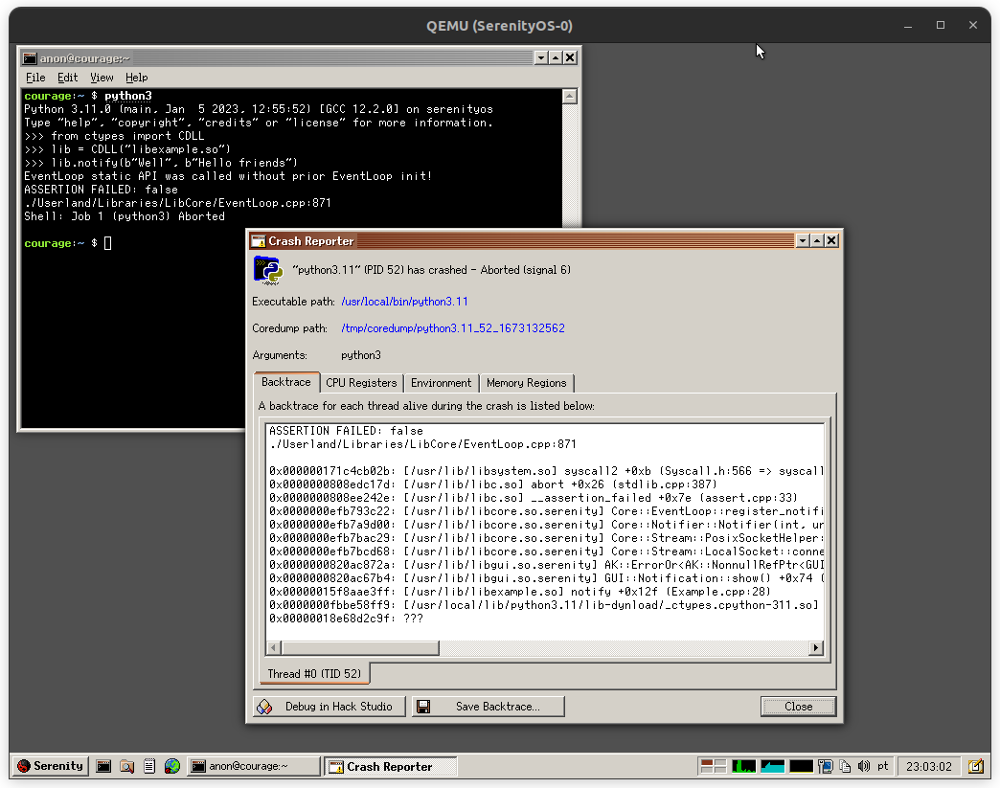
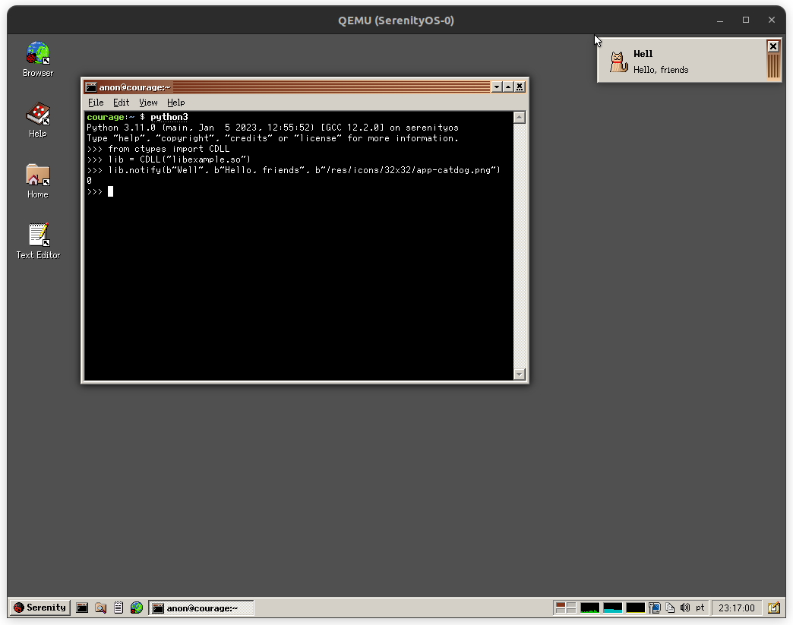

As my first post related to SerenityOS development, I'm going to talk about a topic
which I'm really passionate about -- Python programming!

SerenityOS has a pretty decent port of the Python language, mainly due to the work done by
[Linus](https://linus.dev/) (and other contributors!). Almost every standard library module works as intended, with many 
of its optional dependencies also ported, like *sqlite*, *zlib*, *ncurses*.
Fun fact: [webbrowser module has official support for launching the Serenity's Ladybird Browser](https://github.com/python/cpython/commit/329a47f0524e9d3f43f1e28c4f9e7c088662c030).

One of such optional dependencies is *libffi*, which is a foreign-function interface library.
Having this dependency makes the [*ctypes*](https://docs.python.org/3/library/ctypes.html) module available.

With *ctypes*, we can easily call C compatible functions exported by a shared library, which means
it should be possible to interface with the Serenity C++ classes, providing that we write wrapper
functions in the style of C, and use the `extern "C"` declaration.

Let's build a small "hello world" **C-reni-Py** (😅) program!

## Creating a shared library

To create a shared library the easiest way possible, I'm going to use the same structure
as the other libraries, by creating a new directory in the `Userland/Libraries`.
Let's call it *LibExample*:

```bash
cd serenity
mkdir -p Userland/Libraries/LibExample && cd $_
touch CMakeLists.txt Example.cpp Example.h
```

We're going to build a really simple one-function library that sends (push-like) desktop notifications!

```C++
/* Example.h */
#pragma once

extern "C" {
    int notify(char const* title, char const* text);
}
```

```C++
/* Example.cpp */
#include "Example.h"
#include <LibGUI/Notification.h>

int notify(char const* title, char const* text)
{
    auto notification = GUI::Notification::construct();
    notification->set_title(title);
    notification->set_text(text);
    notification->show();
    return 0;
}
```

Nice! Now, to make the build system compile this code, it's necessary to edit `CMakeLists.txt`:

```CMake
serenity_component(LibExample TARGETS LibExample)
set(SOURCES Example.cpp)
serenity_lib(LibExample example)
target_link_libraries(LibExample PRIVATE LibCore LibGUI LibGfx)
```

I'm not sure if this declaration is entirely correct
(as I don't fully understand the build system), but I found that `serenity_component()`
must be present. Otherwise, the library won't be placed in the OS filesystem
(I assume it's because it's not a dependency of any application).

Now, edit `Userland/Libraries/CMakeLists.txt` and add an `add_subdirectory(LibExample)`
declaration. Build the system and run it. Check that there is a `/usr/lib/libexample.so` file!

## Using the library from Python

Assuming that you already have the Python port installed, let's use the library. 
Open a Python interpreter and type:

```Python
from ctypes import CDLL
lib = CDLL("libexample.so")
lib.notify(b"Well", b"Hello friends")
```

And...



It crashed! (At least the error is pretty cool)

Apparently, before we can create notifications, we need to have an event loop
instantiated, which in Serenity it's done by initializing a `GUI::Application` object. 
I'm not entirely sure why, I think it's related to the way GUI applications communicate
with `WindowServer`.

After declaring a global variable `static RefPtr<GUI::Application> app`, 
I'm going to initialize it in the first invocation of `notify()`. Something like this:

```C++
if (!app) {
    app = GUI::Application::construct(Main::Arguments {});
}
```

And there we go! Displaying a notification on the SerenityOS desktop, via Python: 



(I also introduced an icon file as a third parameter, so I could find a reason to
show the wholesome *catdog* mascot in this post.)

With this approach, it's theoretically possible to build Python bindings for LibGUI (and other components),
but it's really hard work to do that, I think. Another way to build this kind of integration is
to use the [CPython C API](https://docs.python.org/3/c-api/index.html).

That's all for today. I hope you find this post interesting x)
