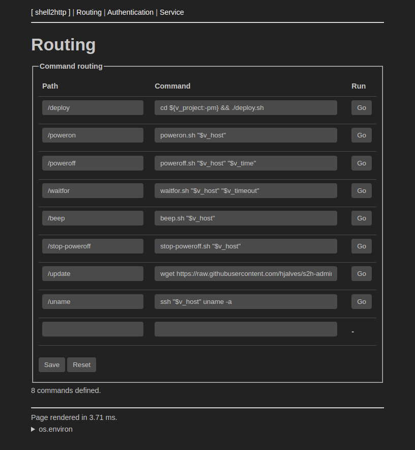
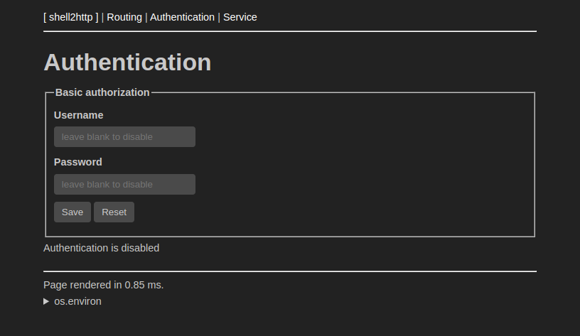
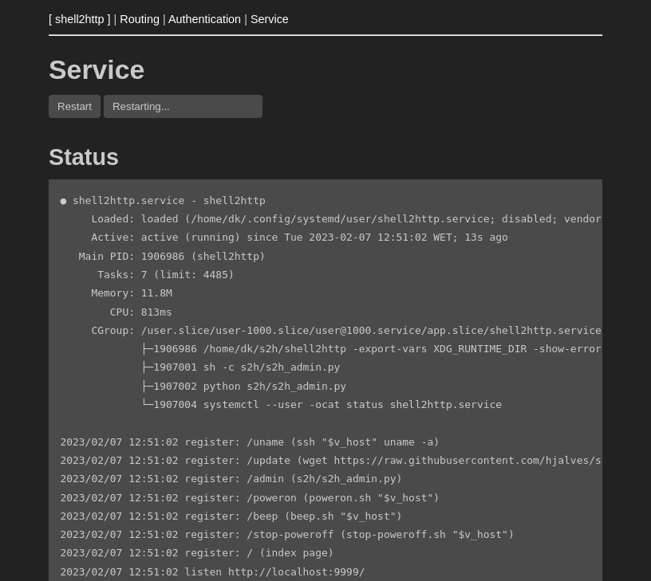

## Introduction

Inspired by [Simon Willison's advice](https://simonwillison.net/2022/Nov/6/what-to-blog-about/),
I've decided to write about this [weird dumb project](https://github.com/hjalves/s2h-admin) 
that I've been doing since a couple of weeks ago.

In my home network, I have many remote control functions that need to be called externally.
These functions are generally written and deployed as shell scripts, stuff like 
"powering on a computer", "turning off a device", "beep with a specific sound", and so on.

Now, if wanted to have perfect security, I should run these scripts via SSH, ideally with
a user created for this purpose. But because I'm a lazy person, I want to be able to run
this with minimal effort and simple authentication. [shell2http](https://github.com/msoap/shell2http)
is the perfect solution to do just that -- it allows the execution of shell scripts
via HTTP, in a way that's very similar to the old CGI style of building web applications.

Using shell2http and a systemd service have been perfect for my own needs. But it
gets annoying having to connect to the machine via SSH, changing the systemd unit file, 
running *daemon-reload* and *restart* everytime I want to add or remove scripts.

So I had this great (or terrible) idea to make a web administration interface
where I could change the available scripts, username and password used for authentication,
and restart the service with the newly configured parameters.

However, I wanted to make the easiest possible deployment, using shell2http
as the "application server" and Python as the language for building 
the app, due to the fact that I'm very familiar with it, and it's present
by default in all major Linux distributions. To achieve these goals my 
constraints were the following:

- It should be written in a single Python file
- No Python/CSS/Javascript dependencies whatsoever

## Starting from the systemd unit file

When I started making this project, my unit file was very simple, something like
this:

```systemd
[Unit]
Description=shell2http

[Service]
Type=simple
ExecStart=/usr/bin/shell2http -show-errors -include-stderr -form -port 9999 \
    /poweron 'scripts/poweron.sh "$v_host"' \
    /poweroff 'scripts/poweroff.sh "$v_host"' \
    /beep 'scripts/beep.sh "$v_host"'
WorkingDirectory=/home/user/
Restart=always

[Install]
WantedBy=default.target
```

`-form` is particularly useful for my needs, because it can convert GET parameters
and POST form data into environment variables (ie: GET `parameter` is passed into
the executable as an environment variable `v_parameter`). 
File uploads are also supported, see the documentation for more details.

My first change was to remove the path-script declarations from this file and put
in a separated `.env` file. The way to do this is to add a `EnvironmentFile` declaration:

```systemd
EnvironmentFile=-/home/user/s2h/s2h.env
ExecStart=/home/dk/s2h/shell2http -show-errors -include-stderr -form -port 9999 \
    /admin "s2h/s2h_admin.py" $SH_ROUTES
```

I've already put there a `/admin` route to serve this app. 
Meanwhile, the environment file will have this format:

```env
SH_BASIC_AUTH=user:pass
SH_ROUTES=/poweron 'poweron.sh "$v_host"' /poweroff 'poweroff.sh "$v_host"'
```

`SH_BASIC_AUTH` is used natively by shell2http to add optional basic authorization.
`SH_ROUTES` is where we'll end up putting the path-script declarations. This way,
it gets very easy to programmatically edit the configurable parameters,
and it's not necessary to call `daemon-reload` anymore for every little change
(just `restart` will do it).

## Building the web interface

To concentrate on functionality while minimizing design-related stress,
I stole a pre-existing classless CSS library and saved it into a Python string.
I chose: [sakura.css](https://github.com/oxalorg/sakura).

For the base HTML structure, I'm using the relatively obscure `Template()` from 
the standard library:

```python
from string import Template

HTML_TEMPLATE = Template(
    f"""<!doctype html>
<html lang="en">
<head>
  <meta charset="utf-8">
  <title>Admin > $title</title>
  <style>{CSS}</style>
</head>
<body>
  <nav>$navigation<hr></nav>
  <main>
    <h1>$title</h1>
    $content
  </main>
  <footer>$footer</footer>
</body>
</html>"""
)
```

The problem with this method, is that it gets very ugly when there's a need to
generate more dynamic HTML -- template languages were invented for a reason!

For these pages, I've decided to use a nicer (but very slow) way of building HTML
pages, by using the standard library `ElementTree`, which can be used to build
HTML/XHTML documents, and more generally, XML documents.

To simplify and make the page-building process more intuitive and HTML-like, 
I created wrapper classes called `Html` and `HtmlElement` that enables writing 
a document as follows:
```python
h.section(
    h.h1("Title"),
    h.p("Content"),
    h.form(method="post")(
        h.input(type="submit", value="OK")
    )
)
```

It looks nice and beautiful, but I don't recommend doing this for *serious*
projects. If you really want to explore this approach, take a look at the projects
[pyxl](https://github.com/gvanrossum/pyxl3) and [mixt](https://github.com/twidi/mixt/).
They're modifying the Python language (with monkey patching and other cool ways)
by allowing the use of HTML-like syntax natively, akin to JSX.

I think this model of building web applications has so much unexplored potential,
combined with libraries like [Tailwind CSS](https://tailwindcss.com/)
and [htmx](https://htmx.org/), now you just need a single language
to write pages and components.

## Making a development server

People generally know that Python has a built-in simple static/CGI web server, 
`python -m http.server`, which is a very handy tool. What many don't know is 
that it's really easy to build your own custom development web server on 
top of the standard library `wsgiref` module, by implementing the WSGI 
protocol in your app.

I say development server, because when writing for production, there's many 
edge cases that are quite hard to get right, that's why micro-frameworks like
Flask and Bottle exist in the first place.

I think this feature is quite nice, because this way you don't need shell2http 
just to see if the pages are being rendered correctly or if the forms are 
behaving as expected.

This is the full web-server implementation:

```python
def wsgi(environ, start_response):
    try:
        if not environ.get("PATH_INFO") == ADMIN_ROUTE:
            raise LookupError(f"Not found. Use {ADMIN_ROUTE} path only.")

        variables = dict(parse_qsl(environ.get("QUERY_STRING", "")))
        method = environ["REQUEST_METHOD"]
        content_type = environ.get("CONTENT_TYPE")

        # Handle forms (not handling multipart/form-data as we don't have uploads)
        if method == "POST" and content_type == "application/x-www-form-urlencoded":
            payload = environ['wsgi.input'].read(int(environ["CONTENT_LENGTH"]))
            variables.update(parse_qsl(payload.decode()))

        status = "200 OK"
        headers = [("Content-Type", "text/html")]
        body = render(variables).encode()

    except Exception as ex:
        status = "500 Error"
        headers = [("Content-Type", "text/plain")]
        body = f"{ex.__class__.__name__}: {str(ex)}".encode()

    start_response(status, headers)
    return [body]
```

`render(variables)` is where all the logic/routing/rendering is done. To run this
`wsgi()` function in the Python's builtin WSGI server, forever, just call:

```python
from wsgiref.simple_server import make_server, WSGIServer
make_server("localhost", 9998, wsgi, WSGIServer).serve_forever()
```

This is a single-threaded webserver, but you can customize it to be threaded or to 
use a thread-pool, like this:

```python
class ThreadedWSGIServer(ThreadingMixIn, WSGIServer):
    pass

class ThreadPoolWSGIServer(ThreadingMixIn, WSGIServer):
    pool = ThreadPool(4)

    def process_request(self, request, client_address):
        self.pool.apply_async(
            self.process_request_thread, args=(request, client_address)
        )
```

How neat! I could use this solution to fully replace shell2http, but I'm not
inclined to, because I trust way more that project than my own code :)

## Some screenshots

Here is some screenshots of the app. It is kinda ugly at the moment,
but it is what it is...

---



---



---



## Next steps

To make this project perfect for me, it should automatically download and install
shell2http binary when missing, create a systemd unit file, and update itself
from the repository. The look and feel could also be improved, I guess.

## Conclusion

I hope you found anything useful or at least interesting here. I'm not 
recommending this project or shell2http to anyone, this all feels like a 
big security nightmare, but if you're really inclined to use this, at least 
run it behind a reverse proxy with a better authentication mechanism :)

If you want to take a look at the full code, this is the repository:
https://github.com/hjalves/s2h-admin.

The code is not that interesting apart from the stuff I mentioned here, and it's
very messy, but I appreciate if you have any suggestion on how to improve it.

Thanks for reading 😊
